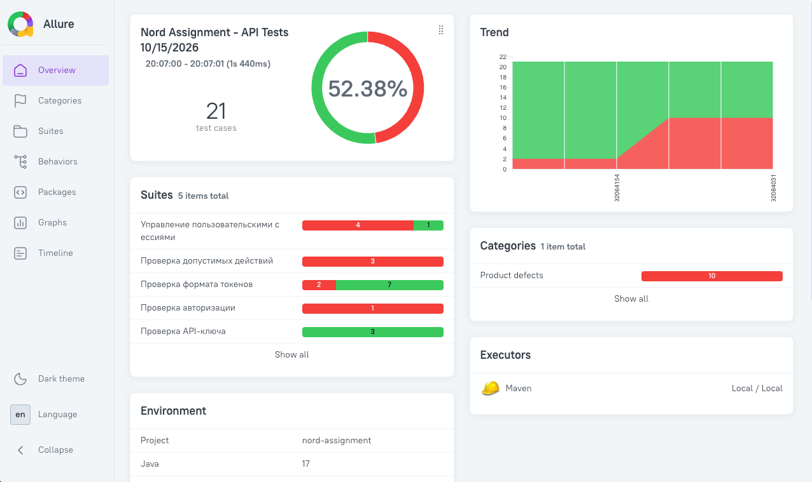

# Nord Assignment — API Test Automation

Автоматизированные API-тесты для тестового задания.

Проект реализован на Java с использованием REST Assured, JUnit 5 и WireMock.

## Технологии

- **Java 17**
- **Maven** — сборка и управление зависимостями
- **JUnit 5** — запуск и организация тестов
- **REST Assured** — тестирование REST API
- **WireMock** — эмуляция ответов внешних сервисов
- **AssertJ** — проверки ожидаемых результатов
- **Allure 2** — отчётность

## Тестовое покрытие

Реализован **21 тест-кейс**, охватывающий:

- Валидацию токенов и параметров запроса
- Авторизацию пользователя (`LOGIN`)
- Проверку допустимых значений `action`
- Проверку API-ключа
- Выполнение действий (`ACTION`)
- Завершение сессии (`LOGOUT`)
- Управление пользовательскими сессиями и их изоляцию
- Обработку ошибок внешних сервисов

Внешние сервисы `/auth` и `/doAction` эмулируются с помощью WireMock.

## Запуск тестов

### Требования

- Java 17
- Maven
- Запущенное тестируемое приложение на `http://localhost:8080`

Настройки подключения находятся в `src/main/resources/config.properties`.

WireMock запускается автоматически при выполнении тестов на порту `8888`.

### Запуск

```bash
mvn clean test
```

## Allure Report

Для анализа результатов используется Allure 2.



Отчёт содержит результаты тестов, группировку по функциональности, историю запусков (Trend), информацию об окружении и детали HTTP-запросов и ответов.

### Генерация отчёта

После выполнения тестов:

```bash
bash scripts/allure-report.sh
```

Скрипт генерирует HTML-отчёт, обновляет историю запусков и открывает отчёт в браузере.

Для работы скрипта необходим установленный **Allure 2 CLI**.

Повторное открытие уже сформированного отчёта:

```bash
allure open allure-report
```

### История запусков

Каталог `allure-history/` хранится в репозитории, чтобы сохранять историю предыдущих прогонов и отображать её на графике Trend.

Сгенерированные отчёты и результаты тестов не добавляются в Git.

## Известные дефекты

Основная причина падений тестов — расхождение фактического поведения приложения с требованиями.

По ТЗ токен может содержать заглавные латинские буквы `A–Z` и цифры `0–9`, однако фактически приложение принимает только буквы `A–F` и цифры `0–9`. Из-за этого валидные по ТЗ токены, содержащие буквы `G–Z`, отклоняются.

Также в ТЗ не уточняется, допустимы ли токены, состоящие исключительно из букв или исключительно из цифр. Сейчас приложение принимает такие токены, однако я рассматриваю это как потенциальный дефект: ожидаю, что валидный токен должен содержать хотя бы одну букву и одну цифру.

Этот момент требует уточнения требований. Соответствующие проверки включены в тестовое покрытие (`T07–T08`).
